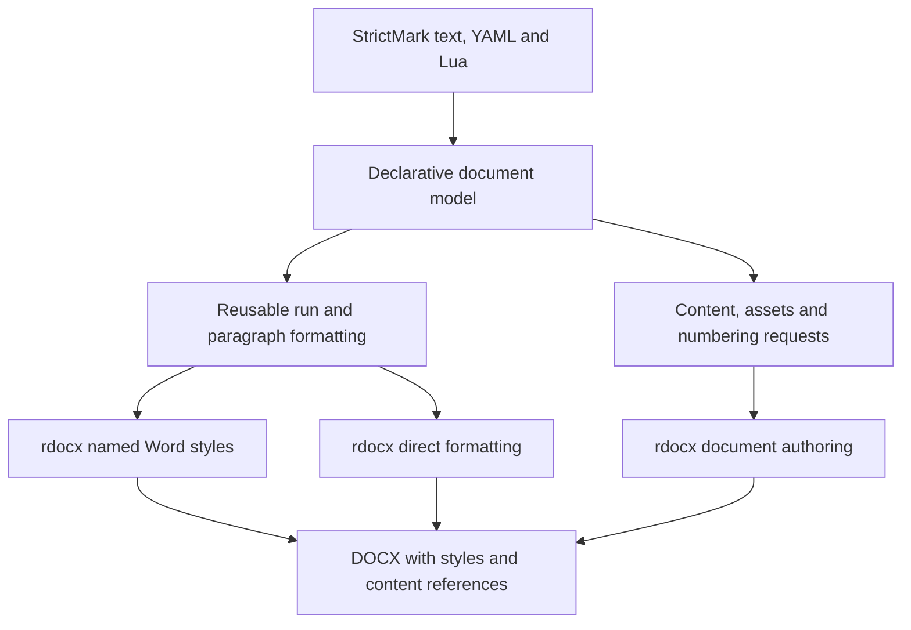

# Shared Word formatting for styles and content

**Status**: Draft for discussion with Andrewkoro105, author of StrictMark.

This proposal responds to [issue #264](https://github.com/tensorbee/rdocx/issues/264).
It describes an API direction for review. The Rust examples below include
proposed types and methods. They are not available APIs or a release promise.
The numbered HLD documents remain authoritative until a feature design is
agreed and implemented through the normal workflow.

## The problem we want to solve

Andrew is building StrictMark, a tool for scientific articles and reports.
Its declarative document layer turns structured content and formatting into
rdocx calls. He wants to describe formatting once and use it on both content
and named Word styles.

In his [10 October reply](https://github.com/tensorbee/rdocx/issues/264#issuecomment-6098877640),
Andrew confirms that the output needs actual Word styles. His current
`base_run` behavior is a temporary workaround. It does not define the final
rules for inheritance or clearing a property.

The first document needs headings, text, lists, images, tables and equations.
His longer-term aim is broad DOCX support through a separate declarative
library. This proposal starts with shared run and paragraph formatting.
Table formatting follows as a separate step.

Sources for this discussion:

- [Andrew's shared-property proposal](https://github.com/tensorbee/rdocx/issues/264#issuecomment-5982015636).
- [StrictMark project description](https://github.com/Andrewkoro105/strict_mark/blob/a4b395381e35c1856fe56d59caf3f65673a1eddc/StrictMarkEn.md).
- [Declarative prototype](https://github.com/Andrewkoro105/strict_mark/tree/a4b395381e35c1856fe56d59caf3f65673a1eddc/src/rdocx_decl).
- [Example documents](https://github.com/Andrewkoro105/strict_mark/tree/a4b395381e35c1856fe56d59caf3f65673a1eddc/example_sm).

The project links above pin the source inspected for this draft. We have read
the prototype, but have not run StrictMark or qualified its full example.

## What works today

`Document` already provides style creation, lookup, updates, removal and default
selection. `StyleBuilder` supports paragraph, character and table styles,
including inheritance and conditional table formatting.

The fluent style methods cover alignment, spacing before and after, left
indentation, font, size, bold and color. Other formatting uses typed properties
such as `CT_PPr` and `CT_RPr`. Paragraphs and runs expose a wider set of
individual setters. This leaves the wrapper with two conversion paths for the
same formatting choices.

`Document::set_style` updates an existing style through a merge with explicit
clear operations. It should not be described as replacing every property.
Style numbering has its own checked operations,
`link_style_to_numbering` and `unlink_style_from_numbering`. Supplying numbering
through a style builder's paragraph properties is refused.

The implementation is in [style.rs](../../crates/rdocx/src/style.rs),
[document.rs](../../crates/rdocx/src/document.rs),
[paragraph.rs](../../crates/rdocx/src/paragraph.rs) and
[run.rs](../../crates/rdocx/src/run.rs). The existing public contract is in
[the bindings specification](10-bindings-spec.md).

## Where the responsibilities sit

StrictMark owns its markup and the rules that turn it into document content.
Its declarative library owns its serializable model and Lua interface.
rdocx owns Word authoring, property conversion, identifiers, relationships and
XML preservation.



A StrictMark style can decide how to number an equation or place an image.
Those decisions can produce Word styles, fields, numbering definitions and
drawings. They do not all become properties in `styles.xml`.

Sections also retain their own settings. A page size or section break should
not become a reusable paragraph style property just because its current
authoring call is on a paragraph handle.

## Proposed shared formatting API

Introduce owned `RunFormat` and `ParagraphFormat` values in the native rdocx
facade. A caller can build a value before borrowing a document, then reuse it
for a style or for direct formatting. Keep existing setters and typed property
access available.

Start with the formatting properties already supported by the run and
paragraph facades that are legal in both contexts. Record the exact property
coverage in the implementation design. Content operations, section settings
and relationship allocation remain separate. Numbering still goes through the
document's checked authoring operations.

Both consumers should use the same concrete property-writing helpers. Existing
setters should share those helpers where needed to prevent different unit,
font or color conversions. This proposal does not require a new trait, crate
or generic framework.

The following is illustrative Rust syntax. It proposes the `*Format` types,
`paragraph_format`, `run_format` and `apply_format` methods.

```rust
let heading = ParagraphFormat::new()
    .keep_with_next(true)
    .space_after(Length::points(8.0));

let heading_text = RunFormat::new()
    .font("Arial")
    .size(16.0)
    .bold(true);

document.add_style(
    StyleBuilder::paragraph("ReportHeading", "Report Heading")
        .based_on("Normal")
        .paragraph_format(heading.clone())
        .run_format(heading_text.clone()),
)?;

document.add_paragraph("Title 1").set_style("ReportHeading");

let mut note = document.add_paragraph("");
note.apply_format(&heading)?;
note.add_run("A one-off note").apply_format(&heading_text)?;
```

The heading paragraph stores a style reference. Its runs can inherit the
style's text formatting. The one-off note receives direct formatting. Reusing
the value does not turn that note into a member of the named style.

Do not copy resolved inherited formatting onto every run. That would make
later style edits ineffective wherever a direct value takes precedence.

## Missing values, overrides and clearing

A format describes local formatting choices. An absent property contributes
no local value. A value such as `false` is explicit and must survive conversion.
When updating existing content, a caller also needs to distinguish leaving a
property alone from removing it.

These are proposed rules for review:

| Intent | Reusable format | Update to existing content or style |
|---|---|---|
| No choice for a property | No local value | Leave the current local value unchanged |
| Set a value | Store that explicit value | Change that property only |
| Set `false` | Store explicit `false` | Keep it distinct from absence |
| Clear a local value | Leave it absent | Remove it so inheritance can take effect |

The normal `apply_format` operation should overlay only the properties supplied
by the format. It should preserve other properties and unmodelled XML. Explicit
clear operations should handle removal. A complete replacement, if needed,
must be a separately named operation.

For example, suppose a run inherits a font size from its paragraph style and
also has a direct size. Applying a format that omits size leaves the direct
size alone. Clearing the direct size lets the paragraph style supply it.

Illustrative update syntax:

```rust
run.apply_format(&RunFormat::new().italic(false))?;
run.clear_size()?;
```

`clear_size` is a proposed method. In the current API,
`set_size_value(None)` clears the direct run size. A caller must not pass
`None` for every missing input field when it means to leave existing values
unchanged.

Word has special rules for toggle properties such as bold in style chains.
Sharing the property-writing code does not make style inheritance identical
to direct formatting. The implementation must test those rules against Word
semantics before promising that a style-level `false` forces inherited bold
off. Use font size for the simple inheritance and clear examples.

The operation names and the representation of explicit clears remain open.
Andrew's temporary `base_run` merge is not a constraint on that choice.

## Andrew's example as the design target

These shortened extracts come from Andrew's 10 October comment. Omitted text
is described outside the code blocks. His [full example](https://github.com/tensorbee/rdocx/issues/264#issuecomment-6098877640)
remains the source for the table syntax and merge cases.

```sm
# Title 1
## Title 2

- elem 1

$A numbered formula is possible$

#(path.png)"
Signature signature signature signature signature signature signature
"
```

The full example also contains a paragraph with an inline formula and longer
list items. The formula text above is his source example, not a validated
LaTeX test. Use a valid mathematical expression when testing conversion.

The second table starts with a heading over four measurement columns:

```sm
[table name 2]
|---|---------------|
| Names | measurement stages |
|   |---|---|---|---|
|   | 1 | 2 | 3 | 4 |
|-d:|-d-|-d-|-d-|-d-|<<
| Anedew | 30 | 40 | 20 | 50 |
```

This extract omits the remaining data rows and caption. His first table also
exercises vertical merges, horizontal merges and cell alignment.

| Part of the example | Expected Word result | Work to check |
|---|---|---|
| Title 1 and Title 2 | Paragraphs referencing real heading styles | Shared paragraph and run formatting, heading levels and inheritance |
| Text and inline formula | Runs and editable Office Math | Existing equation conversion and diagnostics |
| List items | Paragraphs linked to numbering definitions | Existing numbering APIs, including style links where requested |
| Image and signature | Centered image paragraph and caption content | Existing picture insertion, paragraph alignment and caption policy |
| Numbered formula | Editable equation plus the chosen numbering representation | Agree whether the number is text or a field |
| Merged table | Correct grid, spans, vertical merges and cell content | Existing checked table operations, then shared table formatting |

For tables, keep formatting separate from grid structure and merge operations.
A later design should cover table, row and cell values and conditional style
regions. Do not put every table setting into one run or paragraph format.

## Serialization and compatibility

Andrew can keep serializable types and Lua bindings in his declarative library
while their representation develops. That gives him control over field names,
defaults and script behavior. Native rdocx formatting values do not need a Lua
dependency.

Consider upstream serde support for selected public value types when Andrew
can show the desired representation and conversions. That is a separate API
decision. This draft does not choose a JSON, YAML or Lua schema.

The shared formatting API should be additive. Existing setters, unit
conversions and typed property methods retain their behavior. Checked updates
must preserve unrelated source XML and leave the document unchanged on
failure. Existing style graph and numbering checks remain in force.

## How we will check the implementation

The later feature design should make save and reopen the main acceptance gate.
It should include these cases in the existing integration test entrypoint:

- Build equivalent direct formatting and style properties from the same value.
  Check units, font script slots, theme clearing and explicit false values.
- Save and reopen a document with real paragraph and character styles. Inspect
  style definitions and content references as well as resolved appearance.
- Change a heading style after content uses it. Inherited values should change,
  while deliberate direct overrides should remain.
- Apply a format that omits size, then explicitly clear size. Verify the
  difference on existing runs and existing styles.
- Preserve unrelated modeled properties and unmodelled XML through updates.
  Refused updates should leave the original document intact.
- Check Word toggle-property behavior with an independent consumer or oracle.
  A direct-versus-style XML comparison alone cannot prove inheritance rules.
- Build the agreed subset of Andrew's example. Check numbering links, image
  alignment, valid equations and merged-cell structure separately from shared
  formatting. Render comparisons must use deterministic fonts.

Run the applicable repository verification and hash harness. This documentation
proposal does not claim those implementation checks have passed.

## Questions for Andrew

Andrew, please propose changes here or in issue #264. Short examples of what
you want users to write would help us settle the API before either project
depends on it.

1. Would owned run and paragraph formatting values fit your conversion layer?
   Please suggest names or a different call pattern if it would simplify it.
2. Do the omission and clear rules above fit your intended model? An example
   of a YAML or Lua override would help, but the representation can stay in
   your library for now.
3. Which supported formatting properties must the first version cover? Please
   include any gaps in the heading and caption examples.
4. Should equation and figure numbers remain editable Word fields, or should
   StrictMark generate their text? Which behavior should survive edits in Word?
5. When your serde or Lua representation is ready, which small public rdocx
   types would you like to reuse directly?

We can fold agreed suggestions into this document, then define the first
implementation feature. Issue #264 stays open during that discussion.
